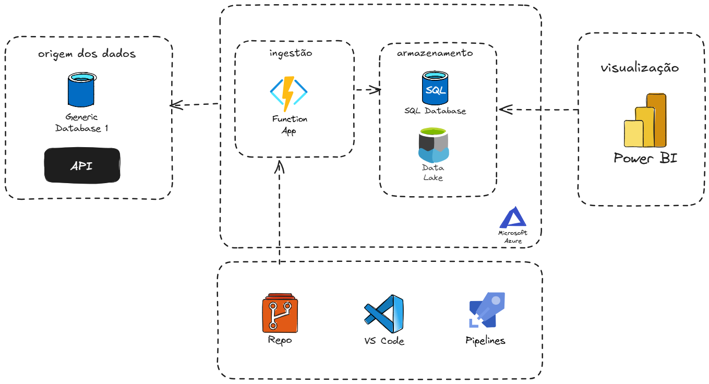

# TAPRC-2026

Projeto da disciplina Tópicos Avançados em Programação — Turma 144C

## Integrantes
- Caio Luis Tirelli
- Leonardo Sussenbach
- Murilo Silveira
- Thainara Hemkemeier da Silva

## Arquitetura

Origem (banco `itsm`) → Azure Function (ingestão) → SQL Database / Data Lake → Power BI.
Código versionado no GitHub, com deploy por pipeline.

## Atividade [2B] — Captura dos dados do banco de origem
`function_app.py` contém uma Azure Function (Timer Trigger, Python) que abre conexão
com o banco de origem e extrai todas as tabelas do `itsm`: analista, categoria, chamado,
chamado_sla, chamado_status_historico, cliente_organizacao, csat_avaliacao, fila, sla, solicitante.

Biblioteca de conexão: **pymssql** (SQL Server / Azure SQL), conforme a pesquisa de bibliotecas da equipe.

### Variáveis de ambiente (as credenciais NÃO ficam no repositório)
| Variável | Descrição |
|---|---|
| `DB_SERVER` | Servidor do banco de origem |
| `DB_PORT` | Porta (padrão 1433) |
| `DB_NAME` | Nome do banco (`itsm`) |
| `DB_USER` | Usuário somente leitura |
| `DB_PASSWORD` | Senha |
| `TIMER_SCHEDULE` | Agendamento NCRONTAB, ex.: `0 */5 * * * *` |

Localmente: copiar `local.settings.example.json` para `local.settings.json` (ignorado pelo git).
No Azure: Function App > Environment variables.

### Rodando localmente
1. `python -m venv .venv` e ativar
2. `pip install -r requirements.txt`
3. `func start`
